<h1 align="center"></h1>

<p align="center">
  <a href="#quickstart">Quickstart</a> ·
  <a href="#what-it-does">What it does</a> ·
  <a href="#documentation">Documentation</a> ·
  <a href="https://github.com/thinkflowlab/nullius/issues">Report an issue</a>
</p>

Nullius runs AI evaluations on your machines and opens every score into the
evidence behind it, so you know whether the agent failed or the benchmark did.\
Add your own benchmark, agent or capability with a single prompt and iterate
faster.

## Quickstart

Python 3.12+ and [uv](https://docs.astral.sh/uv/); a model key to run
benchmarks; Docker or Podman for the container backend; Docker for Harbor.

```bash
uv tool install nullius-eval
nullius serve
```

A specific version: `uv tool install nullius-eval==0.1.0rc2`.\
The main branch, from source:

```bash
git clone https://github.com/thinkflowlab/nullius.git
cd nullius
uv run --no-project --with-requirements app/requirements.txt app/app.py
```

Open **[127.0.0.1:5057](http://127.0.0.1:5057)** to go straight to **Runs**.\
The [Quickstart guide](docs/getting-started.md) covers open results, a first run, the app on another machine, upgrades, wheel installation and migration from a checkout.

```bash
# open job folders from the command line
nullius serve /path/to/harbor/jobs /path/to/other/jobs

# another address or port; APP_HOST and APP_PORT also work as environment variables
nullius serve --host 127.0.0.1 --port 8080
```

Settings, licences, user catalogue entries and runs live outside the installed
package. `nullius paths` shows their locations; `NULLIUS_HOME` selects a separate
profile. Provider keys can be saved in Settings without creating an `.env` file.

## What it does

### Bring anything

*+ Add* on Benchmarks, Agents or Capabilities writes a prompt for your coding assistant. Its import skill pins the upstream, wraps the upstream's own code, proves it and reports what fits; it asks before adding any code of its own. Additions go in your user catalogue and survive application upgrades.

The import skills: `/import-benchmark`,
`/import-standard`, `/import-agent`, `/import-capability`.



### Prove it fits

A benchmark names the ports it needs; an agent or a capability offers a port once its kit passes. Only pairs that fit are offered; a refusal names the missing port.



### Check the benchmark

With no agent, the nop control must score nothing and the oracle everything; the units come out the same twice; no answer sits in a prompt. GSM8K at `openai/grade-school-math@3101c7d`: nop 0/1319, oracle 1319/1319.



### Run anywhere

Several agents and datasets in one run. This machine, a host over ssh, or several machines, one shard each, merged into one job by `cli merge`. The container backend gives each unit's agent or capability its own container. On the Nullius standard a relay per unit holds the key, which the agent never sees, and records every model call.

The Run builder: **Runner → Benchmark → Dataset → Agent → Model → Limits → Where →
Review**. Review checks each machine before Run; follow each trial in the job's
Live view.



### Read the evidence

A failure is the agent's (failed tests, no patch, an agent error), never reached it (rate limits, API and setup errors; the adjusted rate leaves them out), unknown (kept in the denominator), or the benchmark's, when a control finds the task broken. A trial opens into the verifier's report, the trace, the conversation and, with a judge key, a judge model's answers.



### Compare

The same benchmark before and after a change: the tasks both runs share, the ones that disagree first.



*Illustrated with one recorded task; `—` means not recorded.*

## Ways to run

| Way in | Runs | Reads |
|---|---|---|
| **Nullius standard** | Any agent (over ACP) or capability that proved the ports a benchmark needs; or the benchmark's own scripts as published, its *Original* setup. | Harbor-shaped job directories. |
| **[Harbor](https://github.com/harbor-framework/harbor)** | Harbor's task folders in containers, with Harbor's agents. | Job directories from any Harbor agent. |
| **ATIF** trajectories | — | ATIF documents, converted into one job. |
| **OpenTelemetry** spans | — | OTLP/JSON span exports, converted into one job. |

## Reading a result

| Measure | Question it answers |
|---|---|
| **Raw solve rate** | How many of all trials resolved? |
| **Adjusted solve rate** | How many resolved, leaving out infrastructure failures? |
| **Mean score** | For a scored benchmark (a token F1): how high? |

A run with no verdict shows `—`, not 0%.

| You see | It can mean | Where |
|---|---|---|
| Adjusted well above raw | Trials failed before the agent acted | Job page, outcome bar |
| Many unknown outcomes | The run left no verdict | Outcome mix |
| Low trace coverage | Little of the run was captured | Trace, coverage strip |
| A no-op passes, or the oracle fails | The task is broken | Runs page, task checks; Feasibility |
| The judge disagrees | The verifier needs a look | Judgement |

Every metric is in the **[field guide](docs/field-guide.md)**.

## Local by design

Loopback by default; nothing in a source is overwritten. The network serves a
run (model calls, installs, a host), registry lookups and judge calls, nothing
else.

## Documentation

`docs/` also builds into a searchable website: [building and publishing the
site](app/site/README.md).

| Page | Holds |
|---|---|
| [Introduction](docs/README.md) | What Nullius does, where to start |
| [Quickstart](docs/getting-started.md) | Launch, open results, a first run |
| [Core concepts](docs/concepts.md) | Benchmarks, agents, recipes, trials, evidence |
| [Run builder](docs/builder.md) | The stages, the run, Harbor's pin |
| [Read results](docs/results.md) | Failures, controls, comparisons |
| [Judgement](docs/judgement.md) | What a judge model is asked |
| [The Nullius standard](docs/standard.md) | Ports, kits, setups, controls, proofs; importing |
| [Architecture](docs/how-it-works.md) | Execution paths, a run on disk, the pages |
| [Settings](docs/settings/README.md) | Providers, System One, LLM judge, hosts, keys |
| [Benchmarks](docs/benchmarks/supported/README.md), [Agents](docs/agents/supported/README.md), [Capabilities](docs/capabilities/supported/README.md) | What is supported; adding one |
| [CLI](docs/cli/README.md) | Every command, by topic |
| [Metric field guide](docs/field-guide.md) | Every metric and outcome |
| [Repository map](AGENTS.md) | Layout, conventions, test commands |

## Tests

```bash
python3 app/tests/parallel.py
uv run --no-project --with-requirements app/requirements.txt \
  python app/tests/parallel.py app/ui_tests
```

The [tests workflow](https://github.com/thinkflowlab/nullius/actions/workflows/tests.yml)
runs both suites on pull requests; they can also be run locally.

## License

Copyright 2026 Nullius contributors.

Nullius is licensed under the [Apache License 2.0](LICENSE), except where
otherwise noted. Bundled fonts retain their
[SIL Open Font License 1.1](app/static/fonts/README.md). Third-party benchmarks,
agents, capabilities and datasets retain their own licenses.

## Credits

Built by the Nullius contributors. To cite it:

```bibtex
@software{Nullius,
  author = {{Nullius contributors}},
  title = {{Nullius: the run behind a benchmark score}},
  year = {2026},
  url = {https://github.com/thinkflowlab/nullius}
}
```

---

<p align="center"><strong>Nullius in verba.</strong><br>Take nobody’s word for it.</p>
