# Run builder

**Run builder** turns your choices into a recipe and runs it only when you press **Run** from Review.

## Your first run

1. Choose a benchmark. It sets the runner: **Nullius** when the benchmark runs there, [Harbor](#harbor) otherwise. A benchmark that runs on both lets you switch.
2. Choose a dataset.
3. Choose who runs it and the model: only the agents and capabilities that fit, and the providers set in [Settings](settings/README.md).
4. Set the limits; keep the task limit small the first time.
5. Choose the machine in **Where**.
6. In **Review**, meet every prerequisite, then press **Run**.

!!! warning "A run can call paid model APIs"
    Review names what the run will do. The controls `nop` and `oracle` run no agent; a judge or embedding model can still be called.

Then [read its results](results.md).

## Stages

| Stage | Decides |
| --- | --- |
| Benchmark | A catalogue entry of either runner, and a version when it has several (`key@version`). |
| Runner | **Nullius**, [the standard](standard.md#from-the-app), or **Harbor** with its pin ([Which Harbor](#which-harbor)). Only when both are supported. Default: Nullius |
| Dataset | One or more; each dataset with each agent is a job of its own. A benchmark option its datasets need is asked here, for the datasets it applies to. |
| Agent (*Memory* on a memory benchmark) | Reference agents first, or **No agent · Original** for a direct-model benchmark. A benchmark with [agents of its own](standard.md#a-benchmarks-own-agents) (OSWorld's) lists them first, in place of its Original tile; several may be chosen, a job each. Memory benchmarks offer **Original memory** alongside compatible memory capabilities. |
| Model | **Like the paper** keeps what the paper fixed: the model picker shows only documented paper models when the benchmark lists them, and the user simulator and judge are their official models. A benchmark that lists no paper models but has an official simulator or judge leaves the model to you. **Like the leaderboard**, on a benchmark that declares its leaderboard's rules, leaves the model to you and fixes what the leaderboard does: its user simulator and judge, the options it sets and at least its attempts per unit. **Any of your choice** opens the provider's full list and lets the simulator and judge be changed. Nothing fixed by the paper: the paper choice is disabled. **Served by**, on OpenRouter, chooses the serving providers that may answer that model, tried in their order and no other ([Run a benchmark](cli/run.md#serving-providers)). Empty: any of them. |
| Limits | Task limit (empty is every task), a task-name glob, concurrency, attempts per unit (each one scored), retries after an error (never after a failed task), timeouts in minutes. On the Nullius runner, a [spending cap](cli/run.md#a-spending-cap) for the run and one per unit, turns per conversation for a benchmark that holds conversations, a [cap on model calls](cli/run.md#a-cap-on-model-calls) per unit, what each trial keeps of its model calls ([`--exchanges`](cli/run.md#the-exchange-record)), [time limits](cli/run.md#time-limits) per phase in minutes, forced on every participant (empty: the benchmark's or agent's own value, else Nullius's default), then the benchmark's own bounds; a [list of units](cli/run.md#a-list-of-units) is set only on the command line |
| Where | **Hosts**: this machine or Settings hosts. **Sandboxes**: Boat VMs, within the account’s sizes and capacity. Choose isolation where available; VM benchmarks keep their own VM provider |
| Review | One row per decision and the prerequisites. **Run** |

Original setups run on local processes or in Docker; Docker changes isolation only.
A unit whose credential is unset is **not run**; an unset credential the driver
needs to list the units stops the run.

### Prerequisites

Checked on each machine when Review opens, on *Check again*, and as the run starts.

| Need | Asked of | Needed by |
| --- | --- | --- |
| `uv` | `command -v` | The standard; a pinned Harbor. On a host, installed by the run |
| `python3`, `git` | `command -v` on the host | The standard on a host |
| Docker or Podman, its engine answering | The engine's `version` here, `docker ps` or `podman ps` on a host | The standard's container backend; a control in a unit's own image |
| Docker | `docker version` here, `docker ps` on a host | Harbor |
| A benchmark option's machine setup | Its programs | The chosen value; the install commands are shown |
| `harbor` on PATH | `command -v` | A Harbor recipe without a pin |

If the recipe's provider failed its last [test in Settings](settings/model-providers.md#test-a-provider), Review shows a notice. Run still starts.

### Which providers

A provider is *set* when Settings holds its key, or the base URL of a custom provider. Each custom provider is a choice of its own, listed by its name. The Model step offers a provider only where it serves what the recipe's agents speak ([protocols](settings/model-providers.md#protocols)): Anthropic for an agent of the standard that speaks `messages`, never for a Harbor recipe.

| Set in Settings | Model stage | Run |
| --- | --- | --- |
| One | That provider, nothing to choose | Open |
| Several | A choice among them | Open |
| None | Every provider that fits | Disabled until a provider is configured |
| A recipe naming one that is not set | Kept, marked *not set in Settings* | Disabled until another is chosen |

A recipe of controls alone needs no key unless the benchmark uses a judge or embedding model.

| Provider | Key | Endpoint |
| --- | --- | --- |
| OpenRouter | `OPENROUTER_API_KEY` | `https://openrouter.ai/api/v1`, fixed |
| OpenAI | `OPENAI_API_KEY` | `https://api.openai.com/v1`, fixed |
| Anthropic | `ANTHROPIC_API_KEY` | `https://api.anthropic.com/v1`, fixed |
| Custom | The provider's key, optional (placeholder `local` without it) | The provider's base URL, required |

Renaming a custom endpoint keeps its recipes. A recipe without an `endpoint` uses the one at
`MODEL_API_URL`. If an endpoint was removed, choose another to enable Run.

The Model step searches the selected provider's catalogue.
Keys stay on the Nullius host. Choose a result to use its exact model ID, or
enter an ID manually if the catalogue is unavailable. An Original setup with
a declared model list keeps those published choices.

### Saved recipes and drafts

| What | Where | When |
| --- | --- | --- |
| Draft | The browser, one per browser | Saved on every change; *Start over* forgets it |
| Saved recipes | `recipes/<id>.json` under the user data directory, one file each | Any browser lists and loads them. Save and Delete work only from a browser on the application host. An existing name updates its recipe. Saving a loaded recipe under a new name renames it. Import and export as JSON. |
| A run's recipe | `runs/<name>/run.json` | Job page, *New run like this*: the same recipe, at Review. |
| A job's record | Its `config.json` and `lock.json` | *New run like this* without a kept recipe: rebuilt, what it cannot carry named |

*Import* adds a recipe file, or a list, and refuses the whole file when one
recipe is bad. Import, Duplicate
and Delete work only from a browser on the application host.

## Run

| Rule | Detail |
| --- | --- |
| Order | `nop`, `oracle`, then the agents under evaluation |
| Each Run | A new job (recipe name + timestamp); never resumes |
| Key and endpoint | Passed to the run; logs redacted. Other secrets withheld |
| A host | Gets the running backend and effective catalogue, source edits and user entries included, no configuration stores |
| Proofs | Local runs save to the user catalogue. A host's proofs come back beside `jobs/`; the user catalogue is unchanged |
| Docker or Podman | Must answer `ps`, or the run stops before it starts |
| Stop | Ends the current part (exit 130), records `stopped`; the next part never starts |
| Delete launch | Once every run of the launch has ended. Deletes each run's `<RUNS_DIR>/<name>/` (a shard per machine included), every job of the launch, their judgements unless a copy of a job is found under another run or a workspace's root, or one of those roots cannot be read, and each run's copy on its host when ticked. A run still going is refused: stop it first. A launch with jobs from elsewhere has no Delete |
| Restart of Nullius | Reattaches; the job goes back into the workspace it started in, under the name a rename gave it, while that workspace exists, without opening it. The workspace open before the restart opens again. One process follows a runs folder: a second `nullius serve` on it stops with a message |
| Cannot run from the page | Generated tasks and custom agents are not supported by Run |
| Refused | Reads *refused* on the runs page, with why; the job was never written |
| Files | `<RUNS_DIR>/<name>/`: script, log, `run.json`, `jobs/`; default `runs/` under the user data directory (`nullius paths`) |

## Harbor

Harbor's tasks, run by Harbor's agents through the Harbor the recipe pins. What changes:

| Stage | On Harbor |
| --- | --- |
| Dataset | Hub, registry, a local folder or generated tasks; one dataset per recipe |
| Agent | The pinned Harbor's agents; custom agents as `module:Class`; the controls. |
| Model | `<provider>/<model>` (a custom endpoint as `openai/`), with `LLM_API_KEY`, `OPENAI_API_KEY` and the provider's `*_BASE_URL`. The selected provider is kept; model IDs retain their vendor prefix |
| Where | One machine, with Docker. An agent's own vendor credentials come from [Custom keys](settings/agent-keys.md) |
| Podman | A Harbor recipe runs Harbor's docker environment. On Podman alone, run Harbor 0.23.0 or later itself with its podman environment, `harbor run -e podman` (with `podman-compose`, or `docker-compose` and Podman's socket), and open its jobs here |

### Which Harbor

Chosen on the Runner stage, kept in the recipe's `harbor` field.

| Choice | The recipe keeps | Offered |
| --- | --- | --- |
| Release | `{kind: "release", version, extras}` | PyPI's five newest releases, the newest preselected |
| Repository | `{kind: "repo", repo, revisionKind, revision, commit, extras}` | Any git URL, private forks included; then a branch, tag or commit |

| Rule | Detail |
| --- | --- |
| The pin | The commit: a branch or tag is resolved when picked. Review names it (`harbor 0.24.0 · PyPI`); `lock.json` records which Harbor ran |
| Built here | A repository's commit, once, into `harbor-pins/<pin>/` beside the runs (`HARBOR_PINS`); a release is not built |
| Run | Through `uvx`, outside this application's interpreter |
| No pin | Runs the `harbor` on PATH; Run asks for a pin first |
| New run like this | A job whose `lock.json` names a PyPI release opens pinned to it |

- [Read results](results.md)

    From a score to the trial behind it.

- [Settings](settings/README.md)

    Providers, keys and hosts.

- [The standard](standard.md)

    Ports, proofs, setups and controls in full.

