# Run builder

**Run builder** turns your choices into a recipe and runs it only when you press **Run** from Review.

## Your first run

1. Choose a benchmark. It sets the runner: **Nullius** when the benchmark runs there, [Harbor](#harbor) otherwise. A benchmark that runs on both lets you switch.
2. Choose a dataset.
3. Choose who runs it and the model: only the agents and capabilities that fit, and the providers set in [Settings](settings/README.md).
4. Set the limits; keep the task limit small the first time.
5. Choose the machine in **Where**.
6. In **Review**, meet every prerequisite, then press **Run**.

!!! warning "A run can call paid model APIs"
    Review names what the run will do. The controls `nop` and `oracle` run no agent; a judge or embedding model can still be called.

Then [read its results](results.md).

## Stages

| Stage | Decides |
| --- | --- |
| Benchmark | A catalogue entry of either runner, and a version when it has several (`key@version`) |
| Runner | **Nullius**, [the standard](standard.md#from-the-app), or **Harbor** with its pin ([Which Harbor](#which-harbor)). A choice only when the benchmark runs on both; Nullius is preselected |
| Dataset | One or more; each dataset with each agent is a job of its own. Each shows its proofs. A missing or expired credential is named once, linked to **Settings → Data providers** (Hugging Face) or **Custom keys** |
| Agent (*Memory* on a memory benchmark) | Reference agents first, or **No agent · Original** for a direct-model benchmark. Memory benchmarks offer **Original memory** alongside compatible memory capabilities. Controls follow separately; each choice has its own settings tab |
| Model | **Like the paper** keeps what the paper fixed: the model picker shows only documented paper models when the benchmark lists them (the filter applies to the selected agent or capability too), and the user simulator and judge are their official models. A benchmark that lists no paper models but has an official simulator or judge leaves the model to you. **Like the leaderboard**, on a benchmark that declares its leaderboard's rules, leaves the model to you and fixes what the leaderboard does: its user simulator and judge, the options it sets and at least its attempts per unit. **Any of your choice** opens the provider's full list and lets the simulator and judge be changed. Nothing fixed by the paper: the paper choice is disabled. **Served by**, under each model field when the provider is OpenRouter: the serving providers that may answer that model, typed as slugs or added from the model's providers, tried in their order and no other ([Run a benchmark](cli/run.md#serving-providers)). Empty: any of them. Review shows them in its Model row |
| Limits | Task limit (empty is every task), a task-name glob, concurrency, retries, attempts per unit, timeouts in minutes. On the Nullius runner, a [spending cap](cli/run.md#a-spending-cap) for the run and one per unit |
| Where | This machine, a Settings host, or several machines, one shard each, merged into one job. The backend: *local processes*, as you, with the explicit yes to running unsandboxed; or *Container*, on Docker or Podman. A benchmark option's machine setup is installed on a click (`sudo -n`), or its commands are given |
| Review | One row per decision and the prerequisites. **Run** |

Original setups run on local processes or in Docker; Docker changes isolation only.
A unit whose credential is unset is **not run**; an unset credential the driver
needs to list the units stops the run.

### Prerequisites

Checked on each machine when Review opens, on *Check again*, and as the run starts (`app/nullius/prerequisites.py`).

| Need | Asked of | Needed by |
| --- | --- | --- |
| `uv` | `command -v` | The standard; a pinned Harbor. On a host, installed by the run |
| `python3`, `git` | `command -v` on the host | The standard on a host |
| Docker or Podman, its engine answering | The engine's `version` here, `docker ps` or `podman ps` on a host | The standard's container backend; a control in a unit's own image |
| Docker | `docker version` here, `docker ps` on a host | Harbor |
| A benchmark option's machine setup | Its programs | The chosen value; the install commands are shown |
| `harbor` on PATH | `command -v` | A Harbor recipe without a pin |

For the standard, the Docker row says when the engine has `userns-remap`, which [the standard](standard.md)'s containers run outside of.

If the recipe's provider failed its last [test in Settings](settings/model-providers.md#test-a-provider), Review shows a notice. Run still starts.

### Which providers

A provider is *set* when Settings holds `OPENROUTER_API_KEY`, `OPENAI_API_KEY`, or the URL of an OpenAI-compatible endpoint, for both runners. Each OpenAI-compatible endpoint is a choice of its own, listed by its name.

| Set in Settings | Model stage | Run |
| --- | --- | --- |
| One | That provider, nothing to choose | Open |
| Several | A choice among them | Open |
| None | All three | Disabled until a provider is configured |
| A recipe naming one that is not set | Kept, marked *not set in Settings* | Disabled until another is chosen |

A recipe of controls alone needs no key unless the benchmark uses a judge or embedding model.

| Provider | Key | Endpoint |
| --- | --- | --- |
| OpenRouter | `OPENROUTER_API_KEY` | `https://openrouter.ai/api/v1`, fixed |
| OpenAI | `OPENAI_API_KEY` | api.openai.com |
| OpenAI-compatible | The endpoint's key, optional (placeholder `local` without it) | The endpoint's URL, required |

A recipe on an OpenAI-compatible endpoint records `"provider": "custom"` and
the endpoint's id, `"endpoint": "GPU_BOX"`. The id does not change when the
endpoint is renamed. A recipe without an `endpoint` uses the one at
`MODEL_API_URL`. A recipe on an endpoint that was removed keeps it, marked
*not set in Settings*, and Run stays disabled until another is chosen.

The Model step searches the selected provider's model catalogue: OpenRouter,
OpenAI, or the `/models` endpoint of the selected OpenAI-compatible endpoint.
Keys stay on the Nullius host. Choose a result to use its exact model ID, or
enter an ID manually if the catalogue is unavailable. An Original setup with
a declared model list keeps those published choices.

### Saved recipes and drafts

| What | Where | When |
| --- | --- | --- |
| Draft | The browser, one per browser | Saved on every change; *Start over* forgets it |
| Saved recipes | The browser | Save, Load, Delete, import and export as JSON |
| A run's recipe | `runs/<name>/run.json` | Job page, *New run like this*: the same recipe, at Review |
| A job's record | Its `config.json` and `lock.json` | *New run like this* without a kept recipe: rebuilt, what it cannot carry named |

## Run

| Rule | Detail |
| --- | --- |
| Order | `nop`, `oracle`, then the agents under evaluation |
| Each Run | A new job (recipe name + timestamp); never resumes |
| Key and endpoint | Passed as environment (over stdin to a host), the key to a docker relay as a file; logs redacted. Other secrets withheld |
| A host | Gets a content-addressed snapshot of the running backend and effective catalogue into `~/.nullius/app/<content-id>`, including source edits and user entries but no configuration stores; a Harbor recipe gets its pin's wheels in `~/.nullius/harbor/<pin>/wheels`, and `uv` if missing |
| Proofs | Local runs save to the user catalogue. A host uses a writable copy in its run's `catalogue/`, isolated from the host's own entries; that copy and its proofs mirror back alongside `jobs/`, without changing the active user catalogue |
| Docker or Podman | The engine must answer `ps` (`docker ps`, or `podman ps` for the standard's container backend), or the run stops before it starts |
| Stop | Ends the current part (exit 130), records `stopped`; the next part never starts |
| Restart of Nullius | `execution.restore` reattaches from `runs/<name>/run.json` |
| Cannot run from the page | Generated tasks and custom agents are not supported by Run |
| Refused | Reads *refused* on the runs page, with why; the job was never written |
| Files | `<RUNS_DIR>/<name>/`: script, log, `run.json`, `jobs/`; default `runs/` under the user data directory (`nullius paths`) |

## Harbor

Harbor's tasks, run by Harbor's agents through the Harbor the recipe pins. What changes:

| Stage | On Harbor |
| --- | --- |
| Dataset | Hub, registry, a local folder or generated tasks; one dataset per recipe |
| Agent | The pinned Harbor's agents; custom agents as `module:Class`; the controls. *Common settings* apply to every agent; an agent's `--ak` options sit under its tab; *Extra parameters* override the agent, harness, environment or verifier |
| Model | `<provider>/<model>` (a custom endpoint as `openai/`), with `LLM_API_KEY`, `OPENAI_API_KEY` and the provider's `*_BASE_URL`. The selected provider is kept; model IDs retain their vendor prefix |
| Where | One machine, with Docker. An agent's own vendor credentials come from [Custom keys](settings/agent-keys.md) |
| Podman | A Harbor recipe runs Harbor's docker environment. On Podman alone, run Harbor 0.23.0 or later itself with its podman environment, `harbor run -e podman` (with `podman-compose`, or `docker-compose` and Podman's socket), and open its jobs here |

### Which Harbor

Chosen on the Runner stage, kept in the recipe's `harbor` field.

| Choice | The recipe keeps | Offered |
| --- | --- | --- |
| Release | `{kind: "release", version, extras}` | PyPI's five newest releases, the newest preselected |
| Repository | `{kind: "repo", repo, revisionKind, revision, commit, extras}` | Any git URL, private forks included; then a branch, tag or commit |

| Rule | Detail |
| --- | --- |
| The pin | The commit: a branch or tag is resolved when picked. Review names it (`harbor 0.24.0 · PyPI`); `lock.json` records which Harbor ran |
| Built here | A repository's commit, once, into `harbor-pins/<pin>/` beside the runs (`HARBOR_PINS`); a release is not built |
| Run | Through `uvx`, outside this application's interpreter (`app/nullius/harbor/source.py`) |
| Live board | `app/nullius/harbor/feed.py` registers Harbor's trial hooks and writes `events.jsonl`; a Harbor that writes the feed itself is left alone |
| No pin | Runs the `harbor` on PATH; Run asks for a pin first |
| New run like this | A job whose `lock.json` names a PyPI release opens pinned to it |

- [Read results](results.md)

    From a score to the trial behind it.

- [Settings](settings/README.md)

    Providers, keys and run hosts.

- [The standard](standard.md)

    Ports, proofs, setups and controls in full.

Settings shared by Original and selected participants appear once under Every
agent or Every memory. For LongMemEval, Reading applies to every memory;
Separate notes is available only for Original with chain-of-note reading.
