# Architecture

The pieces of the application, its four execution paths, and what each leaves on disk.

## The pieces

`app/web/`, the Flask side, one module per capability; `app/nullius/`, the backend, one package per purpose, no Flask; `app/templates/` and `app/static/`, the interface.

Root `pyproject.toml` packages the backend as `nullius` and the web layer
and its assets as the private `_nullius_app` package. The unified CLI loads
Flask only for `serve`; backend commands do not import it.

Bundled resources are read-only. User config, data and cache roots come from
`nullius.paths` ([locations](settings/README.md#storage)); the user catalogue
overrides bundled entries by whole folder. No personal data lives in the wheel.

## Path 1: open results that exist

| Step | Detail |
| --- | --- |
| Recognised | Nullius and Harbor jobs (one shape); ATIF trajectories; OTLP/JSON span exports |
| Folder picker | Matching folders appear as you type, including mounted disks and linked directories |
| Refused | Any other root, with the reason |
| From a shell | `nullius import <tree> -o <root>` ([Import a run](cli/import.md)) |
| Refresh | *Refresh runs* re-parses and re-converts |

## Path 2: build a recipe and run it here

| Recipe | Runs |
| --- | --- |
| Nullius | [The standard](standard.md): agents or capabilities that proved the benchmark's ports, several per run, or its own scripts as Original |
| Harbor | Harbor's task environments through the Harbor it pins ([Which Harbor](builder.md#which-harbor)) |

## Path 3: the same on an SSH host

`nop`, `oracle`, then the agents; a failed part pauses the run: Continue or Stop. Stop, restart, credentials and what cannot run from the page: [Run](builder.md#run).

For the standard, the host receives a deterministic snapshot of the running
backend and effective catalogue, addressed by its contents. Source edits and
user entries travel together; configuration, credentials and licence stores
are excluded. Local source runs use the current checkout.

## What a run leaves behind

| File | Read for |
| --- | --- |
| `config.json` | Agent, model, dataset, job name |
| Job `result.json` | Totals, start and end |
| `events.jsonl` | The live board |
| Trial `result.json` | Outcome, reward, exception, phase timings |
| `agent/trajectory.json` | Conversation, tool calls, tokens |
| `agent/gateway.log`, `agent/direct.log` | Trace evidence, provider errors |
| Other `agent/*.json` | Trace documents, saved trace views |
| `verifier/` | Reward, test output |
| `lock.json` | Which Harbor ran |

## What the workspace keeps

These paths are below the user data directory, or `WORKSPACES_DIR` for the
workspace root. `nullius paths` shows the active location.

| Path | Holds |
| --- | --- |
| `workspaces/<name>/workspace.json` | Roots, label, opened time |
| `workspaces/<name>/jobs/<hash>.json` | Parse cache |
| `workspaces/<name>/imported/` | Converted foreign roots |
| `workspaces/<name>/judgements/<job>/<trial>.json` | Judge records |

## Page by page

| Page | Shows |
| --- | --- |
| `/runs` | Runs by launch; `?view=all` the flat table |
| `/job/<id>` | Trials, or the live board while it runs |
| `/trial/<job>/<name>` | Conversation, trace, artifacts, judgement |
| `/job/<id>/reconcile` | Outcome versus judged failure cause |
| `/job/<id>/feasibility` | Oracle and nop brackets, broken tasks |
| `/compare` | Runs, whole or matched by task |
| `/benchmarks`, `/agents`, `/capabilities`, `/kits` | Catalogue cards and entry pages; each section expands into a list in the left navigation |

- [CLI](cli/README.md)
- [Judgement](judgement.md)
- [Run builder](builder.md)

