# Judgement

A judge model answers fixed questions about a trial, beside the evidence and never in its place.

Two judgements per trial, a tab each, records in `judgements/` and `judgements-llm/`.

| Judgement | Answers |
| --- | --- |
| [System One](settings/system-one.md) | A yes/no's probability, a choice's distribution, a score, each with a confidence; one call per state |
| [LLM judge](settings/llm-judge.md) | What a chat model states, one JSON object per state, no confidence |

The job, compare, feasibility and task-instruction pages ask System One. A record names its judge and model; TypeSafe's estimates are calibrated on its own calls.

!!! note "A judge never changes an outcome, a count or a verdict"

## Inspect one failed trial

1. Open a failed trial; read its verifier output and conversation first.
2. Request a judgement in the judge's tab; compare it with the recorded error.

!!! warning "Every request is a model call"
    Start with one trial, not a whole job.

Follow the evidence: a recorded rate limit is a provider's failure whatever the judge says.

## From a trial to an answer

## Kinds of answer

| Kind | Returns | Shown as |
| --- | --- | --- |
| Choice | An option and a confidence | The option, a confidence bar |
| Score | A level and a confidence | The level, a confidence bar |
| Yes/no | A probability | *Raised* or not; *undecided* inside its noise floor |

## Which page asks what

| Page | Asks |
| --- | --- |
| `/trial`, Judgement tab | `task_completed`, `failure_cause`, quality, behaviour flags |
| `/job` | *judge* buttons: trials that judge has not judged; *Task instructions*: `instruction_quality` |
| `/job/<id>/reconcile` | The classifier against the judge |
| `/compare` | *Better of two*: `task_satisfaction` per side |
| `/job/<id>/feasibility` | *Triage*: `control_failure_cause` |

## The questions

| Question | Kind | Asked on |
| --- | --- | --- |
| `task_completed` | Choice | Every judged trial |
| `failure_cause` | Choice, with `other` | Unresolved trials |
| `transcript_quality`, `user_facing_answer` | Score | Every judged trial |
| `repeated_failed_action`, `cycled_without_progress`, `broke_stated_prohibition`, `ignored_stated_requirement`, `tampered_with_checks`, `stopped_before_finishing`, `claim_unsupported` | Yes/no | Every judged trial |
| `likely_outcome` | Choice | Trials the classifier left `unknown` |
| `rereading_reads_as`, `retrying_reads_as` | Choice | Trials with re-reads or retries |
| `instruction_quality` | Score | Once per task |
| `task_satisfaction` | Score | Matched pairs on compare |
| `control_failure_cause` | Choice | A misbehaving control |
| `hygiene` pair | Yes/no | Every call |

## Reconcile

## Records and cost

| What | Detail |
| --- | --- |
| Where | `workspaces/<name>/judgements/<job>/<trial>.json` below the user data directory (`WORKSPACES_DIR` can override it), never in the job tree |
| Version | `judgement.questions.v2`; v1 records marked *earlier* |
| Cost | A batch button names its calls; each is checked against the token budget (`batch.preflight`) |
| Noise floors | `app/nullius/judge/floors.json`, each yes/no's run-to-run spread, measured once |

- [System One provider](settings/system-one.md)
- [LLM judge provider](settings/llm-judge.md)
- [Read results](results.md)

